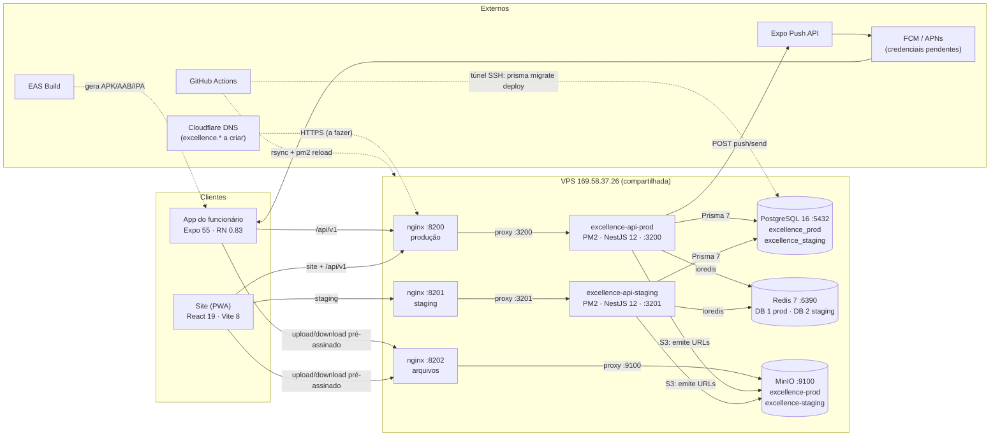
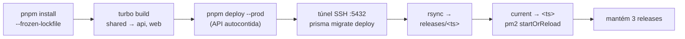

# Arquitetura

Como o sistema roda hoje. Atualizado em 26/10/2026. Os motivos de cada decisão estão em
[`docs/adr`](adr).

## Topologia

## Deploy (push no `main`)

- A VPS não acessa o repositório: tudo é buildado no Actions e só os artefatos sobem.
- Se uma migration falhar, o deploy para antes da troca e a versão anterior continua no ar.
- O `pnpm-lock.yaml` precisa ir no mesmo commit do `package.json`, senão a instalação falha.
- Staging: mesmo fluxo, disparado à mão, por push na branch `staging` ou por PR com a label
  `staging`.
- Bootstrap (manual): aplica as migrations e cria a empresa inicial, os perfis e as contas.

## Ambientes

| Item          | Local (docker-compose)                     | Staging                            | Produção                                |
| ------------- | ------------------------------------------ | ---------------------------------- | --------------------------------------- |
| Endereço      | web `:5173`, API `:3000`                   | `http://169.58.37.26:8201`         | `http://169.58.37.26:8200`              |
| API           | `pnpm dev`                                 | PM2 `excellence-api-staging` :3201 | PM2 `excellence-api-prod` :3200         |
| PostgreSQL    | 16 :5432 · `excellence`, `excellence_test` | `excellence_staging`               | `excellence_prod`                       |
| Redis         | 7 :6379                                    | :6390 DB 2                         | :6390 DB 1                              |
| Arquivos (S3) | MinIO :9000 (console :9001) · `excellence` | MinIO :9100 · `excellence-staging` | MinIO :9100 · `excellence-prod` · :8202 |
| E-mail        | Mailpit :1025 / :8025                      | não configurado                    | não configurado                         |
| Dados         | seed de exemplo                            | seed (`@exemplo.com.br`)           | bootstrap (empresa "Teste")             |
| Deploy        | —                                          | manual / branch `staging`          | push no `main`                          |
| App (EAS)     | `EXPO_PUBLIC_API_URL`                      | perfil `staging`                   | perfis `preview` e `production`         |

## Bancos e dados

- **PostgreSQL 16:** 48 modelos e 18 migrations, com Prisma 7 e adapter `pg`. Extensões
  `pgcrypto` e `citext`.
  - Toda tabela tem `company_id`, e o client do Prisma filtra pela empresa sozinho.
  - Triggers impedem alterar alguns registros: marcações de ponto (com hash encadeado e NSR),
    mês fechado da folha, mensagens dos chamados e ajustes de VA/VT de mês fechado.
  - Contadores atômicos por empresa: NSR do ponto e número do chamado.
- **Redis 7:** só dados temporários, como o bloqueio de login por tentativas e os lembretes de
  push já enviados.
- **MinIO (S3):** o site e o app enviam e baixam direto do storage, por URL pré-assinada de
  5 min. Finalidades: atestado, selfie, foto de perfil, anexo de chamado, ocorrência de ronda,
  documento e planilha.
- **Aparelho (app):**
  - no Keychain/Keystore: refresh token e token de push;
  - no AsyncStorage: fila offline (até 72 h) e cache de 24 h.

## Integrações

| Serviço        | Para quê                   | Situação        |
| -------------- | -------------------------- | --------------- |
| GitHub Actions | build, migrations e deploy | ativo           |
| Expo Push API  | notificações do app        | ativo           |
| FCM / APNs     | entrega do push nas lojas  | pendente        |
| EAS Build      | gerar APK/AAB/IPA          | ativo           |
| Cloudflare DNS | domínio e HTTPS            | a criar (P-029) |
| nginx + PM2    | entrada HTTP e processos   | ativo           |
| SMTP           | e-mail                     | não configurado |

## Versões

| Pacote            | Principais dependências                                                                     |
| ----------------- | ------------------------------------------------------------------------------------------- |
| `apps/api`        | NestJS 12.1, Prisma 7.10, ioredis 6, AWS SDK S3 3.1138, jose 6, argon2 2, pino 5.2, Zod 4.6 |
| `apps/web`        | React 19.3, React Router 8.4, Vite 8.3, TanStack Query 5.103, Tailwind 4.3, PWA 1.3         |
| `apps/mobile`     | Expo SDK 55, React Native 0.83, React 19.2, expo-router 55, Reanimated 4.2                  |
| `packages/shared` | Zod 4.6 (schemas, tipos e client HTTP), tsdown 0.23                                         |
| Monorepo          | Node 22, pnpm 12.6, Turborepo 2.11, TypeScript 6.0 (5.9 no mobile), ESLint 10, Prettier 3.9 |
| Infra             | PostgreSQL 16, Redis 7, MinIO, nginx, PM2                                                   |
